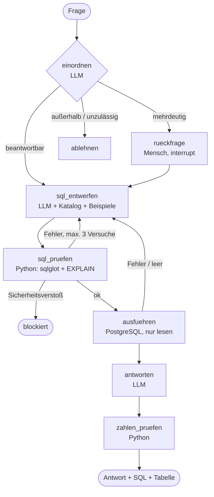

# Frag den Neuwagenmarkt — ein Analytics-Agent, dem man Zahlen glauben kann

**Wie zuverlässig beantwortet ein LLM-Agent Analystenfragen auf 37 Millionen amtlichen
Neuzulassungen — und welche Bausteine machen aus einer Text-to-SQL-Demo ein Werkzeug, das ein
Fachbereich ohne SQL nutzen darf?**

Der Agent übersetzt Fragen in normaler Sprache in SQL, führt sie auf PostgreSQL als
Nur-Lese-Benutzer aus und antwortet mit belegten Zahlen. Bei mehrdeutigen Fragen fragt er nach,
Fragen außerhalb der Daten lehnt er ab, Schreib- und Systemzugriffe blockiert er. Gemessen wird
gegen **42 Fragen mit vorher festgelegten Sollwerten** und **12 zurückgehaltene Holdout-Fragen**.

**Stack:** LangGraph · LangChain · Ollama (Cloud `gpt-oss:120b`, lokal) · PostgreSQL · sqlglot ·
Streamlit · Python

---

## Warum das Problem echt ist

Im BI-Projekt [eu-ev-tariff-detour](https://github.com/alex-sagert/eu-ev-tariff-detour) ergab
dieselbe Frage an Databricks Genie zwei Zahlen: **18,35 % → 22,6 %** ohne Definition,
**14,87 % → 46,14 %** mit Definition. In den eigenen Projektunterlagen stehen für den
PHEV-Anteil chinesischer Marken außerdem 14,6 → 47,2 % (Halbjahre) und 14,9 → 46,1 %
(je zwölf Monate). Alles rechnerisch richtig — andere Nenner, Zeitfenster, Länderkreise.
**Ein Agent ohne verbindliche Definitionen muss raten, und er rät plausibel.**

## Ergebnisse

| Profil | Goldset (42) | falsch ohne Warnung | Holdout (12) | falsch ohne Warnung |
|---|---:|---:|---:|---:|
| **A** — nur Schema, `gpt-oss:120b` | 33 | **7** | 9 | **3** |
| **B** — semantische Schicht, `gpt-oss:120b` | **41** | **1** | **12** | **0** |
| **C** — semantische Schicht, `llama3.2` (3B) lokal | 7 von 39* | 17 | – | – |
| **E** — semantische Schicht, `qwen2.5-coder:7b` lokal | 27 von 41* | 3 | 9 | 2 |

\* Abbrüche nicht im Nenner (C: 3, E: 1).

Mit semantischer Schicht stellt der Agent alle Rückfragen (3/3), lehnt alle Fragen außerhalb der Daten ab
(4/4) und blockiert beide Sicherheitsfragen. Die Baseline antwortet stattdessen zum Beispiel
„2025 wurden in Polen **None** Elektroautos zugelassen“ — Polen ist nicht im Datensatz.

Lokal zeigt sich ein Zielkonflikt: Das 7B-Modell mit Schicht gibt weniger falsche Zahlen aus als das
120B-Modell ohne (3 statt 7), fragt aber bei 23 von 41 Fragen unnötig nach — vorsichtig statt falsch.

Lauf 1 fand vor allem Fehler der eigenen Pipeline (JSON-Format, zu knappe Datenbeschreibung,
Doppelrundung); nach einer dokumentierten Verbesserungsrunde folgten Lauf 2 und das Holdout.
Details: [`docs/PROJEKTTAGEBUCH.md`](docs/PROJEKTTAGEBUCH.md), je Frage: `eval/ergebnisse/`.


| Profil | Kontext | Modell |
|---|---|---|
| A — Baseline | nur Schema + Beispielzeilen (Stand Lerntag 9) | Ollama Cloud `gpt-oss:120b` |
| B — semantische Schicht | + Spaltenkommentare, Fachbegriffe, Beispielabfragen, Einordnung, Rückfrage, Zahlenprüfung | Ollama Cloud `gpt-oss:120b` |
| C — semantische Schicht lokal | wie B | Ollama lokal `llama3.2` |
| D — Baseline lokal | wie A | Ollama lokal `llama3.2` (nicht gelaufen) |
| E — semantische Schicht lokal | wie B | Ollama lokal `qwen2.5-coder:7b` |

Kernmetrik ist **„plausibel-falsch“**: eine falsche Zahl ohne Warnung, Rückfrage oder Ablehnung.

## Architektur



**Grundsatz aus dem Spesen-Agent: Das LLM macht nur, was Python nicht kann.**

| Aufgabe | Wer |
|---|---|
| Frage einordnen, SQL entwerfen, Ergebnis formulieren | LLM |
| passende Beispielabfragen finden | BM25-Retrieval über `semantik/beispiele.yaml` |
| SQL prüfen, ausführen, rechnen | Python + PostgreSQL |
| jede Zahl der Antwort gegen das Ergebnis prüfen | Python (`agent/zahlen.py`) |
| Definition wählen, wenn mehrdeutig | Mensch |

**Drei Sicherheitsstufen:** Prompt („nur SELECT“) → SQL-Parser (`agent/sql_guard.py`: nur
SELECT, nur Schema `markt`, keine Systemtabellen und -funktionen) → Datenbankrolle `agent_leser`
(nur SELECT, Transaktion read-only, Timeout 15 s).

## Daten

| Tabelle | Inhalt | Zeilen |
|---|---|---:|
| `markt.zulassungen_monat` | Monat × Land × Marke × Modell × Antrieb, EEA co2cars 2021–2025 | 191.227 |
| `markt.zulassungen_jahr` | dasselbe je Jahr, inkl. Fahrzeuge ohne Zulassungsdatum | 24.557 |
| `markt.kba_monat` | KBA FZ 28.4, nur Deutschland, 01/2025–08/2026 | 3.504 |
| `markt.kba_halter_monat` | KBA FZ 28.3, Haltergruppen | 560 |
| `markt.marken`, `laender`, `antriebe` | Stammdaten, China eng/weit, Heimatmarkt | |

Aggregiert aus 37,1 Mio. Einzelzulassungen mit den Regeln des BI-Projekts (`data/build_data.py`);
die Zeilenzahlen sind identisch mit dessen Gold-Schicht. Quelle: Europäische Umweltagentur
(EEA, VO (EU) 2019/631) und Kraftfahrt-Bundesamt.

## Schnellstart

```powershell
py -3.12 -m venv .venv
.\.venv\Scripts\Activate.ps1
pip install -r requirements.txt
copy .env.example .env          # PG_ADMIN_PASSWORD und OLLAMA_API_KEY eintragen
python data/load_postgres.py    # Datenbank, Tabellen, Nur-Lese-Rolle
python test_verbindung.py
python main.py "Wie hoch war der BEV-Anteil in den Niederlanden 2025?"
streamlit run app.py
```

Ohne lokales PostgreSQL: `docker compose up -d`, in `.env` `PG_PORT=5433` und
`PG_ADMIN_PASSWORD=postgres`. Ausführliche Anleitung: [`docs/ANLEITUNG.md`](docs/ANLEITUNG.md).

## Evaluation

```powershell
$env:LLM_PROVIDER="orakel"; python eval/eval.py --profil B --neu; Remove-Item Env:LLM_PROVIDER   # Pipeline-Test ohne LLM: muss 42/42 sein
python eval/eval.py --profil A B          # Cloud-Läufe, Ergebnisse je Frage in eval/ergebnisse/
python eval/eval.py --profil C E          # lokale Modelle (ollama pull llama3.2 / qwen2.5-coder:7b)
python eval/eval.py --set holdout --profil A B E   # erst ganz am Ende
python eval/eval.py --tabelle             # Ergebnistabelle aus vorhandenen Läufen neu schreiben
```

- **Sollwerte vor dem Lauf:** `eval/goldset.json` enthält je Frage eine von Hand geschriebene
  Referenzabfrage und den Sollwert; `eval/goldset_pruefen.py` rechnet sie gegen die Datenbank nach.
  Feld `beleg` verweist auf die Zahl im BI-Projekt.
- **Gemessen wird das Abfrageergebnis**, nicht der Antworttext — deterministisch, ohne LLM-Gutachter.
- **Kein Leck:** Die Beispielabfragen in `semantik/beispiele.yaml` überschneiden sich nicht mit dem Goldset.
- **Holdout:** 12 Fragen, die erst nach allen Verbesserungen laufen.
- **Orakel:** `LLM_PROVIDER=orakel` ersetzt das LLM durch die Referenzlösungen. Damit sind Graph,
  Prüfung, Datenbank und Bewertung ohne Kontingent testbar.

## Aufbau

```
agent/       config.py (Profile, Modelle) · graph.py · nodes.py · sql_guard.py · zahlen.py · katalog.py · db.py · llm.py · orakel.py
semantik/    katalog.yaml (Fachbegriffe) · beispiele.yaml (Few-Shot)
data/        csv/ (Agent-Daten) · referenz/ · kba/ · sql/01_schema.sql · load_postgres.py · build_data.py
eval/        goldset.json · holdout.json · eval.py · goldset_pruefen.py · ergebnisse/
tests/       Sicherheits- und Zahlenprüfung ohne LLM
main.py      Konsolenprogramm · app.py Streamlit · test_verbindung.py
```

Jede Datei mit einer Zeile erklärt: [`docs/PROJEKTSTRUKTUR.md`](docs/PROJEKTSTRUKTUR.md).

## Grenzen

- Die Zahlenprüfung prüft, ob eine Zahl im Ergebnis vorkommt — nicht, ob sie der richtigen Marke zugeordnet ist.
- Die semantische Schicht wurde für diese Daten geschrieben; ein neues Data Warehouse braucht einen eigenen Katalog.
- Sollwerte gelten für den Datenstand der EEA-Vorabdaten 2024/2025.
- Ollama Cloud (Free) erlaubt eine Anfrage gleichzeitig; Antwortzeiten schwanken. Der LLM-Cache macht Läufe reproduzierbar.
